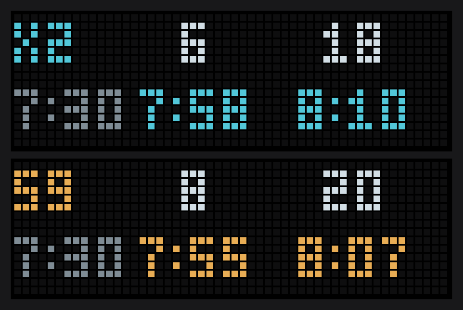

# Kitchen bus display

A quiet, glanceable school-morning bus countdown for the **Ulanzi TC002** pixel clock, using live **WMATA** (Washington, DC Metrobus) predictions. Each route gets its own page. It shows the next two buses you can still catch at your stop, and when each will reach your destination stop. The display stays dark outside the morning window, on weekends and on school holidays.



- **Top row:** route, then minutes until each bus reaches your boarding stop. Buses closer than `min_minutes` (too late to walk to the stop) are hidden, and the next bus moves up.
- **Bottom row:** the predicted clock time that same bus reaches your destination stop. A dim gray time in the corner shows when the data was fetched.
- **Phone page:** a small home-network page (with a panda and a bear) to turn the display on for 30 minutes, off until the next school morning, or back to automatic.

Python 3.11+, standard library only. It uses the clock's stock firmware and its local HTTP API; no firmware changes or MQTT are needed.

## How it works

A small always-on computer on your home network (a Raspberry Pi Zero 2 W works well) polls WMATA about every 30 seconds and pushes a pixel image to the clock's local API.

- **Countdowns** come from WMATA's next-bus API.
- **Destination times** come from WMATA's GTFS-RT trip-update feed, joined to the countdowns by trip ID. The next-bus API alone lists only about three buses per stop, so at the destination stop it rarely includes your bus.
- **No guessing:** trips without a fresh, consistent destination prediction show `-:--` instead of an estimate.
- **Screen pixels** are drawn with a built-in 3x5 bitmap font, because the firmware's own text rendering drops spaces.

> **Known limitation: a frozen screen.** The stock firmware has no expiry for custom apps. If the host loses power or network, the clock keeps showing its last image indefinitely. The fetch-time corner and the stopped page rotation make a frozen screen noticeable, but treat this as a helper, not a guarantee. Keep a transit app as the reference.

## Setup

1. **Get a WMATA API key** from the [WMATA developer portal](https://developer.wmata.com/).
2. **Configure:** `cp config.example.toml config.toml` and replace every PLACEHOLDER value. You'll need:
   - your clock's IP
   - each route's boarding and destination stop codes
   - the destination's GTFS `stop_id`, from `stops.txt` in WMATA's static bus GTFS
   - WMATA's exact `DirectionText` for your direction
   - your time window and school calendar

   `config.toml` is git-ignored.
3. **Add your key** to a git-ignored `.env` file: `WMATA_API_KEY=...`.
4. **Test the clock** from a computer on the same network:

   ```sh
   python3 bus_display.py probe    # read firmware/IP; changes nothing
   python3 bus_display.py test     # shows BUS TEST / NOT LIVE
   python3 bus_display.py blank    # black screen (does not power off)
   python3 bus_display.py prepare  # disable app rotation and text scrolling
   ```

5. **Run live** with `enabled = true`:

   ```sh
   set -a; . ./.env; set +a
   python3 bus_display.py run
   ```

   Ctrl-C blanks the clock and exits.

## Raspberry Pi host

The host must stay on the clock's network: the clock only accepts local HTTP, so a laptop that leaves the house will freeze the screen.

1. **Flash the card.** Use Raspberry Pi Imager with Raspberry Pi OS Lite (64-bit). Set hostname `kitchen-pi`, turn on SSH (public-key authentication) and enter your Wi-Fi details.
2. **Push from your computer.** From a checkout that has a working `config.toml` and `.env`, run:

   ```sh
   ./deploy/push-to-pi.sh USER@kitchen-pi.local
   ```

   This copies the project over SSH (the Pi needs no GitHub access). It then runs `deploy/install.sh`, which:
   - checks for Python 3.11+
   - runs the tests
   - probes the clock
   - installs a `kitchen-display` systemd service

   The service waits for network time, restarts after crashes, and blanks the clock when stopped.

   `sudo` prompts for the Pi user's password. View logs with `journalctl -u kitchen-display -f`. Re-run the push after updating the code.

Never run two hosts against the same clock.

## Phone controls

The `run` process also serves a control page on port **8765**. Open `http://kitchen-pi.local:8765`, or `http://<host-IP>:8765`, on the same network. On a phone, add it to the home screen.

- **Show buses for 30 minutes:** overrides the calendar, then returns to Automatic.
- **Off:** blank until the next scheduled school morning.
- **Automatic:** follow the configured schedule.

Overrides survive restarts. On the Pi they're saved in `/var/lib/kitchen-display/control.json`, and elsewhere in `~/.local/state/kitchen-display/`. A damaged state file falls back to Automatic.

Anyone on your home network can use the page. It has no login, but it rejects cross-site requests and requests addressed to public hostnames. **Do not expose port 8765 to the internet.** Optional `[phone]` keys in the config are `host` and `port`.

## Development

```sh
python3 -m unittest discover -s tests -v   # offline; uses tests/fixture_config.toml and mocks
python3 bus_display.py preview             # example pixel payloads, no network
```

Passing tests do not mean a real bus feed or clock was reached.
